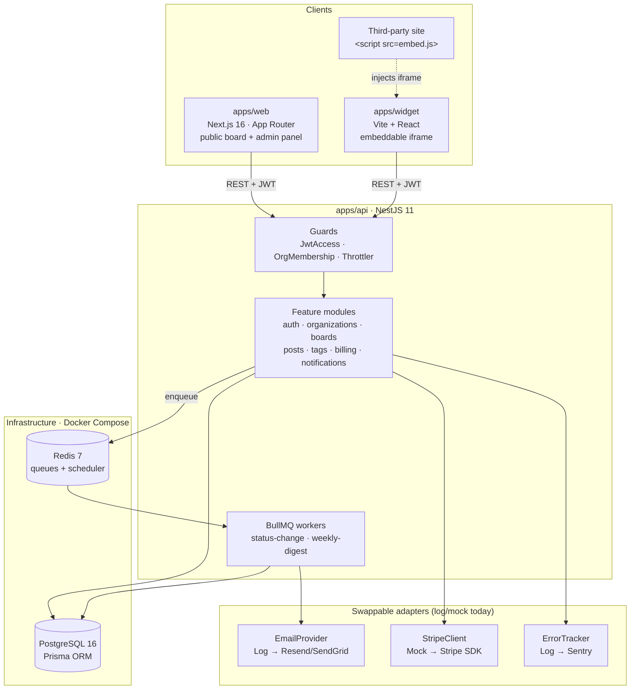

# Feedback & Roadmap Platform

A multi-tenant feedback board, public roadmap, and embeddable widget — a self-built
[Canny](https://canny.io)-style SaaS MVP. Users post feature requests, upvote, and comment on a
public board; the owning team triages them on a drag-and-drop kanban, and status changes fan out to
voters through a background job queue. Built as a pnpm/Turborepo monorepo with a NestJS API,
a Next.js frontend, and a separately-bundled embeddable widget, covered by unit, integration
(real PostgreSQL), and Playwright end-to-end tests running in CI.

> **Note on scope.** This is a portfolio project that runs locally (Docker Compose) and on GitHub —
> there is no hosted deployment. Two third-party integrations (Stripe billing, transactional email)
> are implemented against real interfaces but backed by local mock/log adapters, so the whole
> system runs end to end without a single external account. See
> [Deliberate limitations](#deliberate-limitations).

---

## Contents

- [Features](#features)
- [Architecture](#architecture)
- [Tech stack](#tech-stack)
- [Running it locally](#running-it-locally)
- [Testing](#testing)
- [Architecture decisions](#architecture-decisions)
- [Repository layout](#repository-layout)
- [Deliberate limitations](#deliberate-limitations)

---

## Features

**Multi-tenancy & auth**
- Email/password auth built by hand: bcrypt hashing, short-lived access JWTs, and refresh-token
  rotation with only a SHA-256 hash stored server-side. Reuse of an already-rotated token is treated
  as a theft signal and revokes the whole session, not just the one request.
- Organizations with `OWNER` / `ADMIN` / `MEMBER` roles, email invitations, and org-scoped data
  isolation enforced by a single central guard rather than ad-hoc checks in each service.

**Feedback board**
- Public boards with posts, one-vote-per-user upvoting (enforced by a database unique constraint,
  not just application code), flat comments, status/tag filtering, and text search.
- Admin panel: kanban roadmap with drag-and-drop status changes, duplicate merging (votes are
  transferred, the merged post is tombstoned rather than deleted), tagging, and official replies.

**Embeddable widget**
- A separate Vite + React bundle any site can drop in with one `<script>` tag. The loader is
  React-free and ~1.2 KB; it injects a sandboxed iframe and syncs height and theme over
  `postMessage`.
- Host sites can identify their own users via an HMAC-signed payload (the same shared-secret SSO
  pattern Canny uses), and customize the widget's accent color and logo.

**Background jobs & notifications**
- Redis + BullMQ. Status changes enqueue a job that emails every voter/commenter (deduplicated) and
  creates an in-app notification; a scheduled weekly digest summarizes new and trending posts for
  each org's admins.

**Billing**
- Stripe-shaped checkout and webhook flow: HMAC signature verification over the exact raw request
  bytes, plan upgrades, invoice history, subscription cancellation, and free-plan limits on boards
  and members that surface an upgrade CTA in the UI.

**Production practices**
- Global rate limiting (tighter on auth endpoints), security headers, per-request IDs surfaced in
  both logs and error responses, and a global exception filter that reports 5xx to a pluggable
  error tracker without leaking internals to clients.

---

## Architecture



**Request path.** Every route carrying an `:orgId` passes through `OrgMembershipGuard`, which is the
single place tenant isolation is decided — services never re-check it ad hoc. Public board routes
use an *optional* JWT guard instead: they work anonymously, but return richer data (such as whether
you already voted) when a token is present.

**Why the adapter layer.** Email, Stripe, and error tracking each sit behind an interface with a DI
token. Today each resolves to a local implementation that writes to a log file or verifies
self-signed HMACs; swapping in a real provider means changing one `useClass`/`useFactory` line, and
no calling code moves. This is what makes the project fully runnable without external accounts while
keeping the integration boundaries honest.

---

## Tech stack

| Layer | Choice | Why |
|---|---|---|
| Frontend | Next.js 16 (App Router), TypeScript, Tailwind | SSR/SEO matters for public board pages that should be indexable |
| Backend | NestJS 11 | Module/DI structure keeps a growing domain testable; guards and interceptors give a natural place for cross-cutting concerns |
| Database | PostgreSQL 16 + Prisma 6 | Relational domain (org → board → post → vote); type-safe migrations |
| Queue | Redis 7 + BullMQ 6 | Notifications and the weekly digest; BullMQ's Job Scheduler also provides cron, avoiding a second scheduling library |
| Auth | Hand-rolled JWT (access + rotating refresh) via Passport | Building it rather than adopting a service was a deliberate learning goal |
| Widget | Vite + React, standalone bundle | Next.js runtime is dead weight inside an iframe; the widget must build and version independently |
| Monorepo | pnpm workspaces + Turborepo | Shared types and a single CI pipeline across four packages |
| Tests | Jest (unit + integration), Playwright (E2E) | Three layers, each proving something the others structurally cannot — see [Testing](#testing) |

Requires Node **24** (see `.nvmrc`) and pnpm **11**.

---

## Running it locally

**1. Start infrastructure**

```bash
docker compose up -d
```

Brings up PostgreSQL on `5432` and Redis on `6379`.

**2. Configure environment**

```bash
cp .env.example .env
```

The Postgres/Redis defaults match `docker-compose.yml`. The **secrets are deliberately
non-functional placeholders** (`__GENERATE_ME__…`) — generate your own before starting the API:

```bash
node -e "console.log('JWT_ACCESS_SECRET='+require('crypto').randomBytes(32).toString('hex'));console.log('JWT_REFRESH_SECRET='+require('crypto').randomBytes(32).toString('hex'));console.log('STRIPE_WEBHOOK_SECRET=whsec_'+require('crypto').randomBytes(24).toString('hex'))"
```

Paste those three lines into `.env`. Access and refresh secrets must differ. A boot-time check
([`env.validation.ts`](apps/api/src/config/env.validation.ts)) **refuses to start in production**
on a weak/placeholder/missing secret, and warns loudly in development — so a copy-paste `.env`
can never silently ship a known secret. `apps/api/.env` holds the same `DATABASE_URL` for the
Prisma CLI.

**3. Install and migrate**

```bash
pnpm install
```

```bash
pnpm --filter api exec prisma migrate deploy
```

**4. Seed demo data** (optional but recommended)

```bash
pnpm --filter api seed
```

Creates a demo workspace with a populated board — four posts spread across kanban columns, tags,
votes, and a comment. The script is idempotent and never deletes anything, so re-running it is safe.
Sign in as `owner@demo.local` / `demo1234`.

**5. Run**

```bash
pnpm dev
```

| Service | URL |
|---|---|
| Web (public board + admin) | http://localhost:3000 |
| API | http://localhost:3333 |
| Widget (standalone) | http://localhost:5173 |

The landing page links straight to the seeded demo board and the admin panel.

---

## Testing

Three layers, each deliberately scoped to what the layer below it cannot prove:

| Layer | Command | What it covers |
|---|---|---|
| **Unit** — 214 tests | `pnpm test` | Service logic with Prisma mocked; HMAC signing/verification; React hooks and pure helpers |
| **Integration** — 58 tests | `pnpm test:integration` | Real HTTP through the real Nest app against a **real PostgreSQL**: database constraints, guards actually wired to routes, DTO validation, raw-body webhook signatures, rate limiting |
| **E2E** — 1 flow | `pnpm test:e2e` | A real browser: sign up → create workspace → create board → post → vote → drag a card across the kanban → confirm the status change on the public page |

Integration and E2E tests each use their own database (`..._test` / `..._e2e`) and refuse to start if
the target database name doesn't carry that suffix — a guard added after realizing a wrong
`DATABASE_URL` would have silently wiped development data.

**Why three layers.** Unit tests mock Prisma, so by construction they cannot prove the database
constraints exist — `votes.service.spec.ts` verifies that a `P2002` error becomes a `409`, but it
would stay green if `@@unique([postId, userId])` were deleted from the schema. Integration tests
close that gap. E2E closes the next one: it caught a build regression where adding a file outside
`src/` silently shifted the compiled output path, breaking the API's config loading — invisible to
both Jest layers, which run through `ts-jest` and never touch a real build.

CI (GitHub Actions) runs lint, typecheck, unit, integration, and build in one job, and E2E in a
parallel job with PostgreSQL and Redis service containers.

---

## Architecture decisions

The decisions worth calling out:

**Tenant isolation lives in one guard.** `OrgMembershipGuard` is applied to every route with an
`:orgId` parameter (verified by an integration suite that fails if the guard is ever detached, and
that also asserts `MEMBER`s can't reach `OWNER`/`ADMIN`-only handlers). Membership is checked with a
single `findUnique`, so a non-member gets a uniform `403` whether the org exists or not — probing
IDs at the guard reveals nothing about what exists. One layer deeper, resource lookups that don't
own an `:orgId` (a board, post, or tag fetched by id) return `404` on a cross-tenant miss, again
leaking nothing. Notifications aren't org-scoped at all: they belong to a user, so isolation moves
into the `WHERE id AND userId` clause instead. Public responses never include internal `authorId`s,
and the public tag filter is scoped to the board being viewed — private-board tag names don't leak.

**Refresh tokens are rotated, and only their hash is stored.** Integration tests exposed a real gap
here: the token payload was just `{sub, email}`, and JWT's `iat`/`exp` have one-second resolution —
so two tokens minted in the same second were byte-identical and rotation invalidated nothing within
that window. Adding a random `jti` to the refresh token fixed it. Rotation also does reuse
detection: a token that verifies but no longer matches the stored hash (an old, already-rotated one
being replayed) revokes the entire session — clearing the stored hash so the attacker's *and* the
legitimate user's tokens both stop working, rather than silently rejecting only that one request.
The refresh token is read from its httpOnly cookie only; there is no bearer-header path.

**Webhook signatures are verified over raw bytes.** The Stripe-shaped webhook handler verifies an
HMAC over the exact bytes received, not a re-serialized JSON object, with constant-time comparison.
A timestamp older than five minutes — or dated in the future beyond a small clock skew — is
rejected, so a captured request can't be replayed later. Delivery is idempotent: processed event
ids are stored under a unique constraint, so a redelivered event updates nothing twice (no duplicate
invoice). There's an integration test that signs a body with unusual whitespace specifically to fail
if anything ever re-serializes the payload, plus tests covering replay, future-dating, and double
delivery.

**Secrets are hidden at the ORM layer, not per query.** Adding `Organization.widgetSecret` leaked it
to every org member through methods that returned raw entities. The fix was a client-level Prisma
`omit`, so the safe default is automatic and methods that legitimately need it opt in explicitly.
The regression test for this can only exist at the integration layer — a mocked Prisma always looks
like it isn't leaking.

**Merged duplicates are tombstoned, not deleted.** Votes transfer to the target post; the original
keeps its comments and stays reachable by direct link, and list queries filter it out in one shared
method so the public board and the admin kanban stay consistent automatically.

**The widget is a separate package, not a route in the web app.** It must build, version, and ship
independently, and it can't carry Next.js's runtime into someone else's page. The API client is a
trimmed copy rather than a shared dependency — a small duplication chosen over coupling the widget
to the frontend.

**Rate limiting is a global guard.** Applied via `APP_GUARD` so every new endpoint is covered
automatically, rather than relying on remembering a decorator. Auth endpoints are tightened further.
Tests can disable it through a flag — and a dedicated test turns that flag back off and asserts a
real `429`, so the escape hatch can't silently become a blind spot.

---

## Repository layout

```
canny-mini/
├── apps/
│   ├── api/              # NestJS API, Prisma schema + migrations, seed script
│   ├── web/              # Next.js public board + admin panel
│   ├── widget/           # Vite + React embeddable widget and embed.js loader
│   └── e2e/              # Playwright end-to-end suite
├── packages/
│   └── shared/           # Shared TypeScript types
├── docs/                 # Scope and data-model notes
├── docker-compose.yml    # PostgreSQL + Redis
└── turbo.json            # Task graph and environment declarations
```

---

## Deliberate limitations

Things intentionally left out, with reasons — not oversights:

- **No hosted deployment.** The project ran on Vercel + Railway mid-build, then moved to local-only
  to avoid trial/billing pressure on hosting accounts. All hosting configuration was removed rather
  than left half-maintained in the repo.
- **No Stripe account.** `StripeClient` is an interface; `MockStripeClient` implements a genuine
  HMAC webhook flow in Stripe's exact signature format (`t=…,v1=…`) and serves local stand-ins for
  the hosted checkout and customer portal pages. The verification code path is the real one — only
  the caller is simulated. Delivery is idempotent (processed event ids stored under a unique
  constraint, so a redelivered event never opens a second invoice), and the signed checkout/portal
  links redirect only to origins on the `WEB_ORIGIN` allowlist.
- **No email provider.** `EmailProvider` resolves to an adapter that writes JSON lines to
  `apps/api/logs/emails.log`.
- **Comments are flat.** Threading was out of MVP scope.
- **No member-invite UI.** The invitations API exists and is tested, but was never given a screen.
- **Admin route protection is client-side.** Access tokens live in `localStorage`, so server
  components can't read them. The real security boundary is the API's guards; the client check is
  UX only.
- **Notifications poll every 30 seconds** rather than using WebSockets/SSE — no use case here
  justifies the extra infrastructure.

---

## Project summary

> Built a multi-tenant feedback and roadmap SaaS (a Canny-style product) as a pnpm/Turborepo
> monorepo: a NestJS + PostgreSQL/Prisma API, a Next.js frontend, and a standalone embeddable widget
> that third-party sites drop in with one script tag. Implemented hand-rolled JWT auth with
> refresh-token rotation, centrally enforced multi-tenant data isolation, Redis/BullMQ background
> jobs for notifications and a weekly digest, and a Stripe-shaped billing flow with raw-body HMAC
> webhook verification. Backed it with three test layers — unit, integration against real
> PostgreSQL, and Playwright E2E — running in a parallelized GitHub Actions pipeline; the
> integration and E2E suites each caught real defects that the layer below them could not, including
> a refresh-token rotation gap and a build-output regression.
