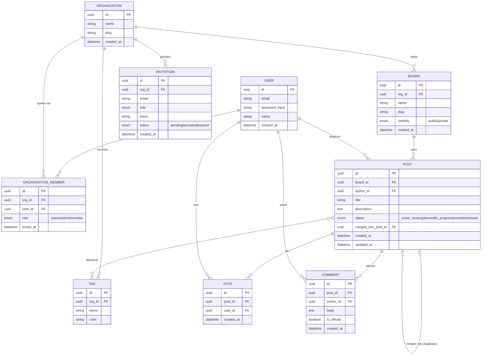

# 0.1 — Kapsam & Veri Modeli

## 1. Kullanıcı Rolleri

| Rol | Kapsam | Yetkiler |
|---|---|---|
| **Owner** | Organization bazlı | Her şeyi yapabilir: billing, org silme, ownership devretme, admin/member atama, tüm admin panel yetkileri |
| **Admin** | Organization bazlı | Board/post/roadmap/tag yönetimi, üye davet etme, resmi yanıt yazma. Billing ve org silme **hariç** |
| **Member** | Organization bazlı | Admin panelini görebilir, post'lara resmi yorum/yanıt yazabilir, status değiştiremez, üye davet edemez |
| **End-user** | Org'a üye değil | Public board'larda post oluşturur, oy verir, yorum yapar. Bir kullanıcı bir org'da End-user, başka bir org'da Owner olabilir (aynı `User` tablosu) |

> Not: End-user için ayrı bir tablo yok — herkes `User`. Bir org'a üyeliği yoksa
> otomatik olarak o org'un public board'larında "end-user" gibi davranır.

## 2. Özellik Listesi (MVP kapsamında)

**Auth & Org**
- Email/şifre ile kayıt-giriş
- Organization (workspace) oluşturma
- Email ile üye davet etme (rol seçerek)
- Org-scoped veri izolasyonu

**Board & Post**
- Board oluşturma (public/private), birden fazla board/org
- Post oluşturma (başlık, açıklama)
- Post status'leri: `under_review → planned → in_progress → complete` (+ `closed`)
- Upvote (kullanıcı başına post başına 1 oy, geri çekilebilir)
- Flat yorum sistemi
- Tag ekleme/filtreleme
- Arama (başlık/açıklama) + status'e göre filtreleme + sıralama (en çok oy / en yeni)

**Admin**
- Roadmap kanban (drag&drop ile status değiştirme)
- Duplicate post birleştirme (oylar toplanır)
- Resmi yanıt / status değişikliği (public'te görünür, `is_official` flag'li yorum)

**Widget**
- Embeddable board widget (iframe + postMessage)
- Embed script (`<script src=...>`)
- Tema (renk/logo) özelleştirme

**Bildirim**
- Status değişince ilgili kullanıcılara email
- Haftalık digest email (org bazlı)

**Billing**
- Stripe ile Free / Pro plan
- Plan bazlı board/üye limiti

## 3. MVP Dışı (Bilinçli Olarak Ertelenenler)

- Public changelog sayfası (Canny'de var, sonraki faza bırakılabilir)
- In-app bildirim merkezi (Faz 5.4'te opsiyonel — zaman kalırsa)
- OAuth/SSO ile giriş (Google/GitHub login) — sadece email/şifre
- Threaded/nested yorumlar (sadece flat liste)
- Anonim oy verme / anonim post (hesap zorunlu)
- Post'a dosya/görsel ekleme
- Zapier/webhook gibi 3. parti entegrasyonlar
- Custom domain (kendi domain'inde board yayınlama)
- İki faktörlü doğrulama (2FA)
- Roadmap için gelişmiş görünümler (timeline/Gantt)
- Çoklu dil (i18n)
- Mobil uygulama
- Free/Pro dışında ek plan kademeleri

## 4. ER Diyagramı

## 5. Kritik Kısıtlar (unique/indeks notları)
- `VOTE`: `(post_id, user_id)` üzerinde unique constraint — bir kullanıcı bir post'a tek oy
- `ORGANIZATION_MEMBER`: `(org_id, user_id)` üzerinde unique constraint
- `BOARD.slug` ve `ORGANIZATION.slug`: org içinde/global unique (public URL için)
- `POST.merged_into_post_id`: kendi kendine referans, birleştirilen post'un oyları hedef post'a taşınır (uygulama mantığında, DB'de otomatik değil)
